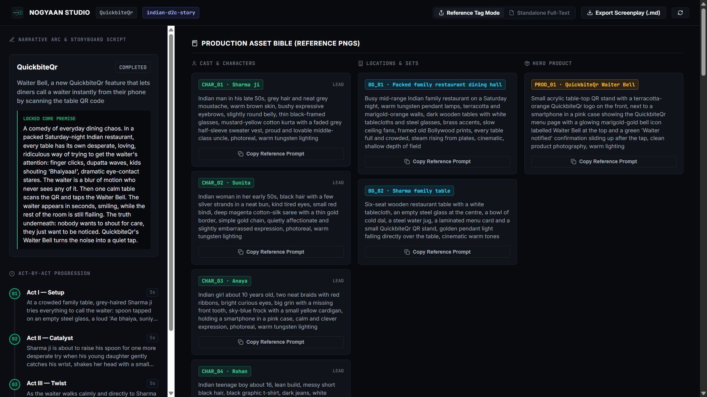

<div align="center">
  

  # nogyaan

  **AI wants to give you gyaan. Real directors just want the shot.**

  An MCP server + Local Director's Workbench that stops Claude from hallucinating multi-scene video scripts. Steer stories with 1 keystroke (`1`, `2`, `3`), prune rejected ideas from context memory, lock your Cast & Set (`CHAR_01`), and compile single-take camera prompts for **Kling 3.0, Veo 3.1, Runway Gen-4.5, and Seedance**.

  [](LICENSE)
  [](https://modelcontextprotocol.io)
</div>

---

## See the Difference in 5 Seconds

Ask normal Claude for a multi-scene ad, and it dumps chatty, multi-cut paragraphs that break video diffusion models and morph your actor's face in every shot:

❌ **Normal One-Shot Claude Prompt (Breaks in Kling / Runway / Veo):**
> *"Scene 3: A 28-year-old tired shopper in a grey hoodie sits at a desk at midnight, then the camera cuts to a close-up of the laptop screen showing filters, then pans out as sunrise light fills the room while a warm narrator says 'Find your outfit today.'"*
> *(Why this fails: Mixes 2 camera cuts in 1 generation, forgets Scene 1 wardrobe details, and makes the actor's lips move to a narrator's voiceover).*

✅ **`nogyaan` Compiled Single-Take Prompt (Locked Continuity + Pure Camera Physics):**
```text
[Refs: @CHAR_01 (The Shopper), @BG_01 (The Apartment), @PROD_01 (CartContext UI)]
35mm Anamorphic f/2.0, low-angle medium close-up, slow continuous dolly push-in.
@CHAR_01 leans back in the desk chair inside @BG_01, one hand covering a quiet laugh as cool cyan light from @PROD_01 reflects across their eyes. Single continuous take, shallow depth of field, zero internal cuts.
On-Camera Lip-Sync: NONE | Post-Prod VO (Premiere): "Built from your feedback." | Cut Note: Match-cut on chair lean.
```

👉 **[See a complete 4-Scene Production Bible generated by `nogyaan` →](/screenplay-quickbiteqr.md)**

---

<!-- REQUIRED BEFORE LAUNCH: Drop 1 screenshot of localhost:4321 + 1 8-second GIF here -->
<p align="center">
  
</p>

---

## ⚡ Install in 10 Seconds

**Option A: Automatic CLI Setup (Claude Desktop, Claude Code & Cursor)**
```bash
npx nogyaan init
```

**Option B: Manual MCP Config (`claude_desktop_config.json` / `.cursor/mcp.json`)**
```json
{
  "mcpServers": {
    "nogyaan": {
      "command": "npx",
      "args": ["-y", "nogyaan"]
    }
  }
}
```

**Option C: Local Development Setup**

Clone the repository and build:

```bash
git clone https://github.com/Gauhar-1/nogyaan.git
cd nogyaan
npm install
npm run build

# Inject local build into Claude Desktop and Cursor
node dist/cli.js init --local

# Verify environment & configs
node dist/cli.js doctor
```

### 💻 CLI Command Reference

| Command | Usage / Example | Description |
|---|---|---|
| `init` | `npx nogyaan init` | Automatically injects `nogyaan` into Claude Desktop (Standard & MSIX), Cursor Global, and Claude Code. |
| `init --project` | `npx nogyaan init --project` | Injects into project-local `.cursor/mcp.json` and `.mcp.json`, and installs `.cursor/rules/nogyaan.mdc`. |
| `init --local` | `node dist/cli.js init --local`<br>`npx nogyaan init --local` | Injects the local repository build into client configs for testing before npm publication. |
| `doctor` | `node dist/cli.js doctor`<br>`npx nogyaan doctor` | Verifies Node.js runtime, build files, port 4321 availability, and audits JSON health across all client configs. |
| `studio` | `npx nogyaan studio` | Directly launches the 2-Pane Director's Workbench UI at `http://localhost:4321`. |
| `presets` | `npx nogyaan presets` | Lists all active narrative cartridges (`presets/*.json`) and their dialogue language rules. |
| `uninstall` | `npx nogyaan uninstall` | Safely removes `nogyaan` (and legacy entries) from all detected client configs without touching other servers. |

---

## How `nogyaan` Works (4 Keystrokes, Zero Prompt Engineering)

1. **Pick a Cultural or Format Cartridge (`/` in Claude's input box):**
   * `/preset-indian-d2c-story` — Indian emotional/humorous storytelling tropes + natural Hinglish dialogue.
   * `/preset-dev-product-launch` — High-tempo SaaS & dev-tool launch videos (strictly 100% English).
   * `/preset-tiktok-ugc-hook` — 3-second scroll-stoppers and direct-response retention arcs.
2. **Branch & Prune (`1`, `2`, `3`, `R`):**
   Claude proposes 3 options for each story beat. When you type `2`, `nogyaan` **physically deletes Options 1 and 3 from `.nogyaan/sessions/`** so rejected ideas never bleed into later scenes, and locks the **physical exit frame** of Scene N so Scene N+1 starts from the exact millisecond the previous shot ended.
3. **Lock Your Cast & Set First (`CHAR_01`, `BG_01`, `PROD_01`):**
   Before compiling camera shots, `nogyaan` locks your character turnaround, environment lighting, and product specs with one-click **Midjourney / Flux reference image prompts**.
4. **Open the 2-Pane Split Director's Workbench (`http://localhost:4321`):**
   Review your full narrative script on the left pane and copy individual scene prompts on the right—toggling effortlessly between **Reference Tag Mode (`@CHAR_01`)** and **Standalone Full-Text Mode**.

---

## `nogyaan` vs. Normal Claude Chat

| Feature | Normal Claude (Web Chat) | 🎬 `nogyaan` (MCP + Workbench) |
| :--- | :--- | :--- |
| **Rejected Ideas** | Stay in chat history forever; cause hallucinations by Scene 3. | **Physically deleted** from state file after every choice. |
| **Scene Continuity** | Teleports characters between shots. | Enforces **Exit-Frame-to-Entry-Frame** physical bridges. |
| **Voiceover vs. Lip-Sync** | Mixes narrator VO into video prompt (ruins actor mouth motion). | Strictly separates **On-Camera Lip-Sync** from **Post-Prod VO**. |
| **Shot Breakdown** | Dumps all scenes in one lazy batch or hallucinates whole scenes. | Compiles **1 shot at a time** via interactive DP pitches (Auteur, Kinetic, Theatrical), yielding to user per shot. |
| **Output Format** | 2,000-word wall of Markdown text. | **The Director's Treatment** (`localhost:4321`) with Live SSE Sync & One-Click Diffusion Copy. |

---

## 🛠️ MCP Tools Reference

| Tool | Valid Stage | Inputs | Description |
|---|---|---|---|
| `list_presets` | Any | None | Lists available storytelling frameworks, descriptions, and strict dialogue rules. |
| `init_brief` | Initial | `company`, `product`, `goal`, `preset`, `brandFriction` | Validates brief, initializes isolated session, and locks stage to `CORE_THEME`. |
| `lock_core_theme` | `CORE_THEME` | `session_id`, `chosen_theme_id`, `theme_title`, `theme_premise` | Locks the overarching Core Campaign Premise (an abstract narrative concept, NOT a physical scene) and transitions stage to `SCENE_1_SETUP`. |
| `branch_scene` | Narrative (`SCENE_1_SETUP` – `SCENE_4_CLIMAX`) | `session_id`, `action`, `scene_number`, `chosen_option_id`, `exit_frame_anchor`, `nextOptions` | Commits physical scene (`1`, `2`, `3`) or regenerates (`R`), wipes pruned branches, and enforces physical continuity bridges. |
| `lock_assets` | `LOCK_ASSETS` (after Scene 4) | `session_id`, `characters` (`CHAR_01..N`), `environments` (`BG_01..N`), `product` (`PROD_01`) | Locks canonical visual asset references and generates Midjourney / Flux reference prompts. |
| `extract_active_assets` | Post-Script | None | Analyzes locked 4-scene narrative to extract the AssetBible and tag active refs (`@CHAR_01`, `@BG_01`, `@PROD_01`) per scene. |
| `pitch_shot_concepts` | DP Suite (Tool A) | `scene_id`, `shot_id` | Pitches exactly 3 human-readable visual intent concepts (Auteur, Kinetic, Theatrical) with zero camera bloat, and completely HALTS execution for user choice (`1`, `2`, `3`). |
| `compile_sota_prompt` | DP Suite (Tool B) | `scene_id`, `shot_id`, `selected_option` ("1" \| "2" \| "3") | Compiles the selected concept into a single dense technical AI video diffusion payload with single-vector camera, spatial light anchoring, and temporal INGRESS/EGRESS handshake for image-to-video looping. |
| `pitch_shot_options` | DP Suite | `scene_id`, `shot_id` | (Backward-compatible) Pitches 3 shot options and completely HALTS execution to yield to the user. |
| `lock_shot_option` | DP Suite | `scene_id`, `shot_id`, `shot`, `spatial_facts` | (Backward-compatible) Locks selected shot option into state, silently updating rolling spatial room geometry. |
| `reroll_node` | Post-Pitch | `node_id`, `user_feedback` | Targeted single-node re-roll without modifying untouched scenes or burning extra tokens. |

---

## 💬 Usage Flow in Claude (Single-Keystroke Frictionless Chat)

1. **Start a new ad session**:
   ```text
   /preset-indian-d2c-story
   company_and_product: ChaiWaale Kadak CTC Spiced Tea
   ad_goal: Reconnect busy corporate workers with afternoon family tea rituals
   ```

2. **Lock core theme & branch physical scenes (`1`, `2`, `3`, `R`)**:
   Claude proposes 3 Core Campaign Premise options. Once locked via `lock_core_theme`, Claude steps through Scene 1 to Scene 4 via `branch_scene` with frictionless single-keystroke inputs.
   ```text
   Reply: 1
   ```

3. **Lock continuity and assets**:
   After Scene 4 Climax, Claude extracts and locks visual assets (`@CHAR_01`, `@BG_01`, `@PROD_01`).

4. **Deferred DP Suite & Temporal Handshake (`pitch_shot_concepts` & `compile_sota_prompt`)**:
   - **Step A:** Claude calls `pitch_shot_concepts` (Tool A) and halts. Reply `1`, `2`, or `3`.
   - **Step B:** Claude calls `compile_sota_prompt` (Tool B). The technical prompt is compiled with strict single-vector camera moves and an **INGRESS / EGRESS temporal handshake**. The end state (`last_shot_egress`) of Shot 1 matches the start state of Shot 2, enabling seamless image-to-video looping in Kling, Runway, and Veo.
   - **Step C:** Reply `N` for Next Shot or `S` for Next Scene. Review everything live on **`http://localhost:4321`**.

---

## 🧪 Testing & Verification

The package includes comprehensive automated verification suites covering FSM safety, CLI injection, MSIX path handling, stdio transport, and architectural bug fixes:

```bash
npm test
```

Test suites executed:
1. `tests/run-verification.mjs` (FSM transitions, anti-jargon gate, sequential pruning, asset ID validation)
2. `tests/test-architecture-and-fixes.mjs` (Preset discovery, session isolation, continuity bridges, kinetic prompts, raw UTF-8)
3. `tests/test-cli.mjs` (OS-aware config resolution, safe merging, doctor diagnostics)
4. `tests/test-stdio.mjs` (Stdio transport handshake with prompts, tools, and resources capabilities)
5. `tests/test-system32-cwd.mjs` (Windows MSIX System32 CWD fallback protection)

---

## 📁 Repository Structure

```text
nogyaan/
├── presets/                    # Dynamic narrative framework definitions
│   ├── indian-d2c-story.json   # Hinglish emotional storytelling
│   ├── dev-product-launch.json # 100% English developer cinema
│   └── tiktok-ugc-hook.json    # 100% English 0-3s retention hooks
├── src/
│   ├── domain/
│   │   └── schemas.ts          # Zod domain schemas and TypeScript interfaces
│   ├── services/
│   │   ├── preset-registry.service.ts # Dynamic preset discovery & loader
│   │   ├── session-dag.service.ts     # Isolated session DAG persistence
│   │   └── prompt-compiler.service.ts # Reference-tagged kinetic prompt compiler
│   ├── mcp/
│   │   ├── prompts.ts          # MCP Slash Command Prompts (/preset-*)
│   │   └── tools.ts            # MCP Tools handler registration
│   ├── state/
│   │   └── dag-store.ts        # Hardened state machine with FSM locks
│   ├── tools/                  # Tool execution handlers (1 to 4)
│   ├── ui/
│   │   └── studio-app.html     # 2-Pane Split Director's Workbench UI
│   ├── cli.ts                  # Cross-platform client injector
│   └── index.ts                # Master stdio MCP server & UI web server
├── tests/                      # Automated verification test suites
├── SKILL.md                    # Claude Code, Claude Desktop & Cursor Skill instructions
└── package.json
```

---

## 📄 License

MIT © MD Gohar Khan
